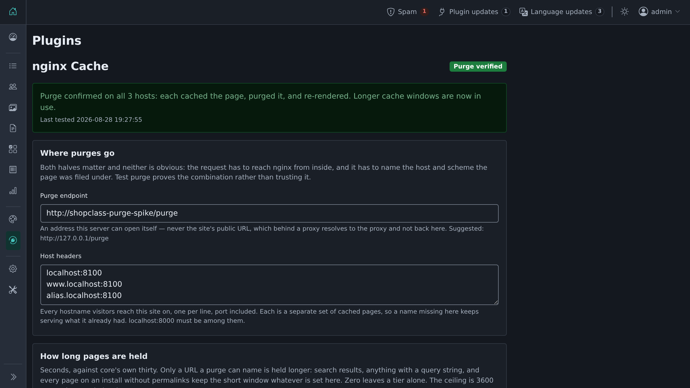

# nginx Cache

Holds pages in nginx's FastCGI cache for an hour instead of thirty seconds, and purges them when a listing changes. For site owners who run their own nginx.

## Requirements

- Shopclass 6.2.0 or later (tested up to 6.4)
- PHP 8.0 or later
- nginx built with `ngx_cache_purge`. It is not in the official image. It builds as a dynamic module against stock nginx (checked on 1.31.3).

The bundled Shopclass Docker image ships it already configured. A standalone install adds it by hand.

## Install

1. Open Plugins → Browse (or upload the zip from the GitHub release).
2. Install.
3. Activate.

(`php oc-cli.php market:install nginx-cache` also works.)

## Set up

1. Open Plugins → nginx Cache: Setup. It prints the Dockerfile, the `load_module` line and the purge `location` block for this install. Add them to nginx.
2. Open Plugins → nginx Cache.
3. Set *Purge endpoint*: an address this server can open itself, never the site's public URL. Default: `$SHOPCLASS_PURGE_ENDPOINT`, else `<nginx's scheme>://127.0.0.1/purge`.
4. Set *Host headers*: every hostname visitors use, one per line, port included. Include `www`, aliases and staging names. The site's own host must be in the list.
5. Optional: set *How long pages are held* (*Listings*, *Static pages*, *Home, category, profile*). Default and maximum are 3600 seconds.
6. Press *Test purge*. The longer window stays off until the test passes.

Where PHP and nginx are separate containers, use the nginx service name as the endpoint, for example `http://webserver/purge`.

## How it works

- Core sends `Cache-Control: public, s-maxage=30`. Until the test passes, the plugin keeps that.
- After a pass, listings, static pages and home, category and profile pages are held up to an hour.
- When a listing changes, these are purged: the listing (one URL per locale), the home page, its category page and the seller's profile.
- Site-wide changes purge everything: a theme switch, a plugin enabled or disabled, or a settings, maintenance, language, currency, widget, category or page change.
- The plugin sends one `PURGE /index.php`. The `purge_all` line from the Setup page clears the whole zone.
- If nginx refuses, the plugin purges what it can name (home, enabled categories, static pages, the sitemap) and retries from cron. *Purge everything now* on the settings page does the same by hand.
- On the Docker image 6.4.2+ with `OSC_MICROCACHE=1`, core purges everything itself through `OSC_PAGE_CACHE_PURGE_URL`. The `purge_all` line is not needed.

## Notes / limits

- It saves origin renders, not page speed. nginx already serves expiring entries stale while it refreshes.
- Not purged, so they keep core's short window: search results with parameters, any URL with a query string, and every page when permalinks are off.
- The test also checks purge-everything and stores the result in `purge_all_ok`. This does not gate the longer windows, but the settings page warns until it passes.
- The `purge_all` line allows `127.0.0.1` only. If PHP runs in another container, add its address.
- Keep `set_real_ip_from` to your proxy only. A wider range lets an internet client pass the purge allow list.
- Times are capped at 3600 seconds. Past that, the form token in a cached page can expire.
- Works with the Cloudflare plugin, which owns the edge. This one owns the origin.

## For developers

Filters:

- `nginx_cache_item_urls`: add URLs for a theme's own listing routes.
- `nginx_cache_purge_urls`: take the whole list and deliver it elsewhere.

Hooks it listens to: `posted_item`, `edited_item`, `after_delete_item`, `enable_item`, `disable_item`, `activate_item`, `deactivate_item`, `item_premium_on`, `item_premium_off`, `item_expiration_updated`, `invalidate_item_cache` (6.2.0+), `add_category`, `after_delete_category`, `edit_page`, `after_delete_page`.

For purge-everything it uses `page_cache_purge` (core 6.4.2+). On older cores it uses `theme_activate`, `after_plugin_activate`, `after_plugin_deactivate` and `admin_form_after_save`, so any admin settings save purges everything on cores 6.2 to 6.4.1.

Settings are stored in the `nginx_cache` section: `purge_endpoint`, `purge_host`, `ttl_item`, `ttl_page`, `ttl_aggregate`. The nginx config is also in [`nginx/shopclass-cache.conf`](nginx/shopclass-cache.conf).

## Support

https://github.com/mindstellar/shopclass-plugin-nginx-cache/issues

## License

GPL-3.0-or-later
